## Dev workflow: ns-O-RAN + `ns-o-ran-gym` (for lab development)

This doc is a **developer-facing** overview of how to iterate on ns-O-RAN scenarios and ML/RL control logic in this repo.

### What you are actually running (two distinct modes)

There are **two different control-loop modes** in this repo. They share the same ns-3 scenario(s), but the control path differs.

```mermaid
flowchart TD
  subgraph gymMode [GymMode_FileControl]
    PythonAgent[PythonAgent]
    GymEnv[TrafficSteeringEnv]
    ActionFile[ts_actions_for_ns3.csv]
    Ns3Scenario[ns-3 scenario-one]
    KpmFiles[KPM CSV files]
    SQLite[SQLite datalake]
    PythonAgent --> GymEnv
    GymEnv --> ActionFile
    ActionFile --> Ns3Scenario
    Ns3Scenario --> KpmFiles
    KpmFiles --> SQLite
    SQLite --> GymEnv
  end

  subgraph ricMode [RICMode_E2AP_E2SM]
    PythonXapp[PythonPolicyInXapp]
    Connector[Connector_E2AP_E2SM]
    RIC[near-RT RIC Bronze]
    Ns3E2[ns-3 E2Termination]
    Ns3E2 -->|E2SM-KPM indications| RIC
    RIC -->|E2AP msgs via RMR routes| Connector
    Connector --> PythonXapp
    PythonXapp --> Connector
    Connector -->|E2SM-RC control| RIC
    RIC -->|E2AP control toward E2 node| Ns3E2
  end
```



- **Gym mode** ("file control"): `TrafficSteeringEnv` writes actions to `ts_actions_for_ns3.csv` and uses POSIX semaphores for step synchronization. ns-3 reads the file and writes KPM-like output files (`cu-*`, `du-*`). The env ingests those files into a local SQLite DB.
  - This is what `ns-o-ran-gym/examples/traffic_steering.py` does today.
  - It is **not** a real near-RT RIC xApp loop.
- **RIC xApp mode** ("E2AP/E2SM control"): an xApp inside the Bronze stack subscribes to **E2SM-KPM** and sends **E2SM-RC** control messages over **E2AP** (via the O-RAN SC plumbing).

### Where to edit code (high-signal map)

- **Gym environment + logging**
  - `ns-o-ran-gym/src/nsoran/ns_env.py`: process orchestration, semaphores, file collection → SQLite.
  - `ns-o-ran-gym/src/nsoran/action_controller.py`: writes `*_actions_for_ns3.csv`.
  - `ns-o-ran-gym/src/nsoran/datalake.py`: SQLite schema + `read_kpms()` query builder.
  - `ns-o-ran-gym/src/environments/ts_env.py`: traffic steering state/action/reward mapping.
- **ns-3 scenario for traffic steering**
  - `ns-3-mmwave-oran/scratch/scenario-one.cc`: the TS scenario (UMi street canyon channel models + control file support).
- **E2SM encoding/decoding on the ns-3 side**
  - `oran-interface/model/kpm-indication.*`: E2SM-KPM header/message encoding.
  - `oran-interface/model/ric-control-message.*`: E2SM-RC control decode path.
  - `oran-interface/model/ric-control-function-description.*` and `oran-interface/model/kpm-function-description.*`: RAN function descriptions and IDs.

### Fast iteration loop (Gym mode)

Use this loop when you are developing:
- new state features / reward shaping
- action-space variants
- dataset collection for offline RL
- baseline RL training (PPO)

**Run** (in the VM):

```bash
cd ~/ns-O-RAN-installation
source .venv/bin/activate

cd ns-o-ran-gym
python examples/traffic_steering.py \
  --config src/environments/scenario_configurations/ts_use_case.json \
  --output_folder output_ts_example \
  --ns3_path ~/ns-O-RAN-installation/ns-3-mmwave-oran \
  --num_steps 200 \
  --optimized \
  --verbose
```

**Key concept**: Gym mode typically relies on `scenario-one`’s default `enableE2FileLogging=true`, so ns-3 **does not need the near-RT RIC** to produce the KPM output files that `ns-o-ran-gym` reads.

### When to bring in the near-RT RIC (RIC xApp mode)

Use this loop when you are validating:
- your "xApp contract" (KPM subscription + RC control)
- end-to-end near-RT behavior and message formats
- deployment assumptions (container, networking, routes)

Starting points in this repo:
- `colosseum-near-rt-ric/setup/sample-xapp/`: sample container that runs a Python script plus a C++ "connector".
- `colosseum-near-rt-ric/setup-scripts/setup-sample-xapp.sh`: builds and runs the sample xApp container.

**Important caveat**: the current sample connector under `colosseum-near-rt-ric/setup/xapp-sm-connector/` is built around **E2SM-HelloWorld**, not KPM/RC. We will extend/replace it to support **E2SM-KPM + E2SM-RC** (see `docs/python-xapp-e2sm-kpm-rc.md` once added).

### Practical knobs for reproducible experiments

- **Short runs**: set `simTime` and `indicationPeriodicity` in `ns-o-ran-gym/src/environments/scenario_configurations/ts_use_case.json`.
- **UE count**: `ues` is "UEs per gNB"; total UEs in `scenario-one` is `ues * 7`.
- **Channel model**: already set to `ThreeGppUmiStreetCanyon*` in `scenario-one.cc`.
- **Control sync**: `useSemaphores` should be enabled for step-by-step external control.

