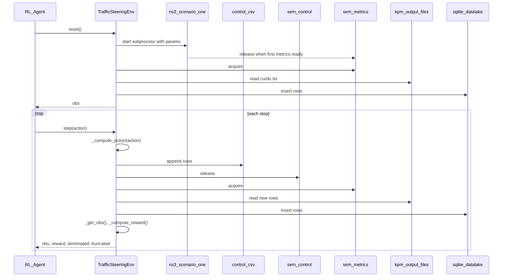

## `ns-o-ran-gym` architecture and extension points

This doc explains how `ns-o-ran-gym` wires **Gymnasium** to **ns-3 (ns-O-RAN)** in this repo, and where to extend it for new scenarios and RL algorithms.

### Key files (read these first)

- `ns-o-ran-gym/src/nsoran/ns_env.py`: base class `NsOranEnv`
- `ns-o-ran-gym/src/nsoran/action_controller.py`: writes the control CSV consumed by ns-3
- `ns-o-ran-gym/src/nsoran/datalake.py`: SQLite DB schema + queries
- `ns-o-ran-gym/src/environments/ts_env.py`: traffic steering environment on top of `NsOranEnv`
- `ns-3-mmwave-oran/scratch/scenario-one.cc`: traffic steering scenario implementation in ns-3

### What `NsOranEnv` actually does (lifecycle)

`NsOranEnv` is the “glue” that:
- builds ns-3 if needed,
- starts an ns-3 process for a chosen scenario,
- synchronizes steps via POSIX semaphores,
- ingests ns-3 output files into a local SQLite “datalake”,
- exposes Gymnasium’s `reset()`/`step()` contract to your RL algorithm.

#### Initialization → build → locate executable

In `ns-o-ran-gym/src/nsoran/ns_env.py`, `NsOranEnv.__init__()` immediately calls `setup_sim()` which:
- sets `LD_LIBRARY_PATH`/`DYLD_LIBRARY_PATH` based on `optimized`,
- runs ns-3 configure/build (unless `skip_configuration=True`),
- loads ns-3 build status to find the executable corresponding to `scenario` (e.g. `scenario-one`).

#### `reset()` → `start_sim()` (creates per-run directory)

On each `reset()`:
- any previous run is cleaned up (`close()`),
- `start_sim()` creates a new UUID directory under your `output_folder`,
- `ActionController` is created with:
  - a human log file (e.g. `TsActions.txt`)
  - a control file consumed by ns-3 (e.g. `ts_actions_for_ns3.csv`)
- `SQLiteDatabaseAPI` is created at `<sim_path>/database.db`,
- two semaphores are created:
  - `metricsReadySemaphore`: ns-3 releases when new metrics are available
  - `controlSemaphore`: Python releases when actions are written
- ns-3 is started as a subprocess, with all `scenario_configuration` parameters passed as `--param=value`.

#### `step(action)` (control + sync + ingest + reward)

On each Gym `step(action)`:
- `_compute_action(action)` converts the Gym action into a list of “control rows”
  - for traffic steering: list of `(ueId, nrCellId)` tuples
- `ActionController.create_control_action(last_timestamp, actions)` appends to the control CSV
- the env releases `controlSemaphore`
- the env blocks on `metricsReadySemaphore` (with timeouts that also detect if ns-3 died)
- `_fill_datalake()` reads any new rows from:
  - `cu-up-cell-*.txt`
  - `cu-cp-cell-*.txt`
  - `du-cell-*.txt`
  and inserts them into the SQLite tables
- `_get_obs()` returns the observation array
- `_compute_reward()` computes and returns the scalar reward

### Sequence diagram (Gym mode)

### Extension points (what you implement for a new environment)

To create a new use case environment:

1. **Choose/implement an ns-3 scenario**
   - You typically add or fork a `scratch/scenario-*.cc` file in `ns-3-mmwave-oran/`.
   - Ensure it can:
     - emit the metrics you need (KPM-like output files), and
     - accept external control (either file+semaphore or E2SM-RC control path).

2. **Create a new env class in `ns-o-ran-gym/src/environments/`**
   - Inherit `NsOranEnv` and implement:
     - `_compute_action(self, action) -> list[tuple]`
     - `_get_obs(self) -> object`
     - `_compute_reward(self) -> float`
   - Optionally implement:
     - `_init_datalake_usecase(self)` to create extra tables
     - `_fill_datalake_usecase(self)` to ingest extra files/metrics

3. **Define a scenario configuration JSON**
   - Under `ns-o-ran-gym/src/environments/scenario_configurations/`.
   - `NsOranEnv` expects a dict where each key maps to a single-element list; it normalizes with `{k: v[0]}`.

### Common pitfalls (specific to this repo)

- **Gym mode vs RIC xApp mode**
  - Gym mode uses `ActionController` + semaphores and typically relies on file-based metric logging in ns-3.
  - RIC mode is a different plumbing path (E2AP/E2SM via RIC); don’t mix the assumptions.
- **File naming / schema mismatch**
  - `SQLiteDatabaseAPI` relies on specific column names matching the CSV headers produced by ns-3.
  - If you change what ns-3 prints, you must update `datalake.py` key dictionaries accordingly.

