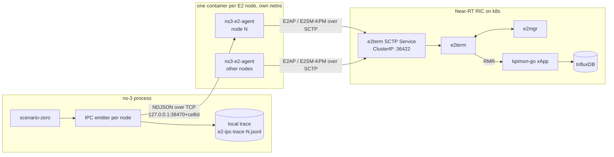

# System architecture: ns-O-RAN on the OSC Near-RT RIC L-release (Approach A)

This note explains how ns-3 scenario-zero reaches the Near-RT RIC after the L-release port, and why it is built that way. Code owns the exact behaviour; this note owns the reasons and the map. Commands are in [deployment-guide-l-release.md](deployment-guide-l-release.md). The decision record, with the alternatives that were rejected, is the dated journal [journals/2026-10-21-p3-e2-agent-design-checkpoint.md](journals/2026-10-21-p3-e2-agent-design-checkpoint.md); it is a snapshot in time and this note does not replace it.

## 1. Outcome and approach

Every E2 node that scenario-zero simulates is served by its own out-of-process E2 agent. ns-3 does not link asn1c or e2sim and does not speak SCTP. Each agent runs in its own container and network namespace, connects to the e2term SCTP **Service** (never a pod IP), and presents itself to the RIC as a separate E2 node. The RIC side is NIST O-RAN-Testbed-Automation v1.8.0 on the L pins, with kpimon-go patched only for an 8-byte TimeStamp.

Why this shape:

- The old design linked an E2 library into ns-3 and ran all nodes in one process. That fixes ns-3 to one asn1c and E2AP version and makes the simulator carry RIC protocol code. The agent boundary moves that code out and lets the RIC side change without touching ns-3 physics.
- Each node needs its own SCTP association, identity and lifecycle, and the RIC must see distinct nodes. One container per node gives that without shared global state.
- NIST's reference node cannot be the agent. Its loop runs a report loop inside the subscription callback and never reads SCTP again, never dispatches a subscription delete, calls `exit(1)` on send or receive errors, and hard-codes its identity. The agent therefore owns its loop and reuses NIST's E2AP generators and asn1c codecs unmodified, editing the generated PDUs in place where they are wrong. No NIST file is changed.

## 2. Components and data flow



| Component | Role | Owner (where to look) |
|---|---|---|
| ns-3 `scenario-zero` | Simulates cells and UEs; builds one sample per node per period | fork of ns-3-mmwave-oran (pin in `scripts/pins.conf`) |
| IPC emitter | Serialises each sample as one JSON line, writes it to the local trace, then sends it to the agent | `oran-interface/model/e2-ipc-*` (fork pin in `scripts/pins.conf`), `oran-interface/README.md` |
| E2 agent | One per node. Speaks E2AP and E2SM-KPM to e2term, forwards ns-3 samples as indications | `O-RAN-Testbed-Automation/RAN_Intelligent_Controllers/Near-Real-Time-RIC/ns3_e2_agent/` |
| e2term Service | The stable address of e2term; survives pod deletes | resolved by `install_scripts/run_ns3_e2_agents.sh` |
| kpimon-go | Subscribes to each connected node, decodes KPM, writes InfluxDB points | NIST `additional_scripts/install_xapp_kpi_monitor.sh` and its patches |
| rc xApp | Takes handover controls on gRPC :7777 and sends them to the named E2 node as E2SM-RC control requests | NIST `additional_scripts/install_xapp_ric_control.sh`; pin `RC_SHA` in `scripts/gates/rc-lib.sh` |
| TS xApp | Per triggered UE, asks for a prediction and calls rc's gRPC when another cell is better by more than the A1 threshold | NIST `additional_scripts/install_xapp_traffic_steering.sh` with the Testbed fork's two patches; pin `TS_SHA` in `scripts/gates/ts-lib.sh` |
| stub QP | An RMR peer that answers the TS xApp's prediction requests from a loaded table | `tools/rmr-peer/` |
| Pacer, R3′ predictor | Lock-step step grants and scripted triggers; the R3′ answer computed from InfluxDB | `scripts/gates/pacer.py`, `scripts/gates/r3p-predictor.py` |
| Gate harness | Builds, runs and judges everything above | `scripts/`, `tools/` |

Placement and transport choices, and what was rejected:

- **Container per agent**, not a Kubernetes pod. This is the path the M2 probe proved (Docker bridge to the ClusterIP). Pods would need an image import into containerd, pod IPs change, and CrashLoopBackOff backoff reaches minutes.
- **ClusterIP resolved at agent start.** Containers cannot resolve cluster DNS, so the launcher resolves the single `service-ricplt-e2term-sctp*` Service with kubectl and passes its IP. The ClusterIP is stable across e2term pod deletes.
- **NodePort SCTP is not used.** Earlier testbed work recorded it as not viable on this stack (not re-tested in this port, unverified).
- **ns-3 to agent is TCP on the loopback**, port `38470 + cellId`. Agent containers publish that port on `127.0.0.1`.

Node identity: each agent registers as a gNB-type E2 node with gNB-ID equal to the ns-3 cellId and PLMN `00101` by default, so e2mgr names it `gnb_001_001_<id as 8 hex digits>`. The LTE eNB (cellId 1) also registers as a gNB-type node while reporting its eNB metric set. Both are deliberate and signed off; they are labelled in the evidence.

## 3. IPC schema v1

The schema is the authority: `O-RAN-Testbed-Automation/RAN_Intelligent_Controllers/Near-Real-Time-RIC/ns3_e2_agent/schema/ns3-e2-ipc.v1.schema.json`. Summary of intent only:

- **Transport.** Newline-delimited JSON over TCP, UTF-8, one object per line, at most 1 MiB per line. Samples flow from ns-3 to the agent; controls and lock-step steps flow back.
- **Messages.** `hello` (sent on every connect: node, kind, period, the wall-clock epoch that maps to sim time 0, run id, emitter SHAs), `sample` (one per node per period: cell sections and a UE list sorted by IMSI, a per-run sequence number, the sim time and the emitter's drop counter), `bye` (final counters).
- **Full-set rule.** A sample carries every value ns-3 computes, regardless of `reducedPmValues`. A later subscription filter (option B) can then live in the agent alone.
- **Exact values.** Doubles use the shortest round-trip decimal so values compare bit for bit. Non-finite doubles are `null`.
- **Trace equals wire.** ns-3 writes the identical line to its local trace before sending, so the trace is the ground truth the gates compare Influx against, including samples dropped because the agent was down.
- **Evolution.** Receivers ignore unknown keys; a new key bumps `minor`, a breaking change bumps `v`. Minor 1 adds `control` (agent to ns-3, a decoded RC handover control) and `controlAck` (ns-3 to agent, its outcome). Minor 2 adds lock-step pacing: the hello's `pacing`, `tStartS` and `tGateS`, and `step` (agent to ns-3, sample k handled). Section 8 explains both.
- **Emitter behaviour.** Non-blocking sends, a bounded buffer that drops and counts on overflow, reconnect with backoff, scheduling at init. In free pacing, the default, ns-3 never waits for a subscription and never stalls simulated time.

Why JSON: the NIST build image already ships a JSON library, ns-3 needs only a small serialiser, shortest round-trip doubles give bit-exact comparison, and the trace file doubles as the wire record. Protobuf would add code generation in two toolchains; CBOR gains nothing here.

## 4. Agent state machine and robustness

The agent is a single-threaded `poll()` loop over the SCTP socket, the IPC listener and client sockets, and a timer. States and timings (defaults in `src/agent-config.hpp`, logic in `src/e2-session.cpp`):

1. **Hold-off**, 8 s after start.
2. **Connecting** on a fresh socket with an **ephemeral SCTP source port**, retried every 2 s without end.
3. **Setup sent.** No E2SetupResponse within 10 s, or an E2SetupFailure, exits with code 3.
4. **Ready.** The subscription table starts empty. A subscription request for the KPM function is admitted and stored, a subscription delete removes the entry and is answered, a service query is answered with a service update, an RC control request is handled as in section 8, and an undecodable PDU is logged and counted, never fatal.
5. **Association lost** exits with code 2. Invalid configuration exits with code 1.

Docker's `--restart always` restarts the container, which returns with empty state and goes through the hold-off to a fresh E2Setup. Every agent writes a JSON stats line every 5 s.

Why these choices:

- **8 s hold-off.** kpimon re-subscribes only after one of its 5 s polls has seen the node not CONNECTED. A faster return leaves a node that is CONNECTED but silent.
- **Ephemeral port.** A reconnect from the same NAT five-tuple can be forwarded to a dead pod's conntrack entry. A new port is a new flow. NIST's kpm_sim uses a fixed 36422, and the probe showed both work for a first connect.
- **Retry forever while connecting.** Exiting because e2term is not up yet would make Docker's restart backoff grow to a minute.
- **Exit on loss, let Docker restart.** It gives the same clean-state path after an agent crash, an e2term pod delete, or a lost setup. The cost is minutes of recovery after an e2term delete, because agents retry until the new e2term has registered with e2mgr. This was measured in the development run of M7.
- **Graceful stop.** On SIGTERM the agent sends an SCTP SHUTDOWN (bounded 2 s wait) while its network namespace still exists, and the stop script uses `docker stop -t 10` before removing the container. Without that, e2term learns of the loss only from heartbeat timeouts, e2mgr keeps a stale CONNECTED node, and kpimon never re-subscribes to it.
- **Subscription option A.** The agent admits the subscription without interpreting the action definition and forwards every sample. Option B (honouring the action definition) would change only the agent.

Constraints from NIST's E2AP generators, handled by in-place edits of the generated PDUs: the subscription response hard-codes a RAN function id, the "not admitted" branch writes into the admitted list, the setup request leaves some OCTET STRING contexts uninitialised, and the indication generator copies into a fixed 8192-byte buffer.

## 5. E2SM-KPM content

Facts checked against kpimon's code (`control.go`, `wrapper.c`) and the golden capture from the reference node:

- **RAN function 2**, short name `ORAN-E2SM-KPM`, and the real KPM OID `1.3.6.1.4.1.53148.1.3.2.2`. kpimon subscribes with function 2 and requires the node to advertise it. Wireshark selects its KPM dissector by the exact short name. e2term accepted the real OID (checked by M5); `E2_KPM_OID=OID123` is the documented fallback.
- **Two report styles** in the function description: style 1 with action format 1 and the **cell** measurement list, and style 3 with action format 3 and the **UE** list. kpimon builds its single action from both lists.
- **Header.** Indication header format 1 with an 8-octet `colletStartTime` in NTP-64 form (seconds since 1900 plus fraction), computed from the hello's epoch plus sim time. kpimon decodes the header and discards its fields; Influx stamps `time.Now()`.
- **Messages.** Both go under kpimon's single subscription, and kpimon dispatches by message format. Cell metrics use **Format 1**, records in exactly the advertised list order with `noValue` for missing values (kpimon drops a message whose record count differs from the list length). UE metrics use **Format 2**, metric-major, then UE by UE in IMSI order.
- **REAL versus INTEGER.** kpimon casts INTEGER to int32. INTEGER is therefore used only for values guaranteed in 0 to 2^31-1 (IDs, bounded per-period counts, percentages). Volumes, bytes, throughput, delay and SINR in dB are REAL. An out-of-range INTEGER becomes `noValue` and is counted.
- **Correlation KPIs.** Both lists start with `ns3.nodeId`, `ns3.simTimeMs` and `ns3.seq`; the UE list adds `ns3.imsi`. The gates join InfluxDB rows to the ns-3 trace on `(nodeId, seq)` and `(nodeId, seq, imsi)`, never on `_time`, because kpimon stamps its own time.
- **Metric map.** `ns3_e2_agent/schema/metric-map.v1.json` maps each ns-3 field (a JSON pointer into the sample) to a KPM measurement name, list, order, id, type and unit. Names must be PrintableString-legal, so `_` is not used and `_Filter` and `.UEID` are dropped from legacy names. The L3 SINR items are flattened into numeric `ns3.l3.*` columns. The agent logs the file's sha256 and advertises its short hash in the function description, and the M6 gate asserts that the hash on the wire equals the file at the pinned commit. `ns3_e2_agent/tests/lint-metric-map.py` checks one type per name, legal characters, and unique stable ids; `install_ns3_e2_agent.sh` runs it before every build.
- **Sizing.** At most four UEs go into one indication, and the chunk is halved if the E2SM message exceeds 7000 bytes, which keeps clear of the generator's 8192-byte buffer.
- **Version mismatch, handled by a rule.** The agent encodes with NIST's KPM v3 asn1c; kpimon decodes with its v2 schema. The structures used are identical in both. The rule is never to set a v3-only extension field. The agent's sender type is `ns-3-sim` because v3 limits it to eight characters.
- **Known dissector noise.** tshark 4.4 still flags two non-indication frames as malformed: NIST's dummy component-config bytes inside the E2SetupRequest (carried unchanged), and kpimon's own subscription request (format 3 action definition encoded with kpimon's v2 schema). Neither comes from this project's code, and the gates require zero malformed indication frames instead.

## 6. kpimon TimeStamp SIZE(8) patch

**Problem.** kpimon's decoder is pre-generated asn1c C for E2SM-KPM v2.0, with `TimeStamp ::= OCTET STRING (SIZE(4))`. KPM v3 nodes, including NIST's reference node, send an 8-byte TimeStamp. The stock decoder returns `RC_WMORE` for the header (and a SIZE(4) decoder that does return `RC_OK` consumes only part of the header and yields a wrong timestamp).

**Change.** `KPIMON_TIMESTAMP_SIZE8=true` makes `install_xapp_kpi_monitor.sh` apply two patches from `install_patch_files/xApps/kpimon-go/e2sm/`: the schema (`asn1/kpm2_0.asn.timestamp-size8.patch`) and the generated constraint tables (`lib/TimeStamp.c.timestamp-size8.patch`). Nothing else in kpimon changes.

**Proof that it is a regeneration, not a hand edit** (`tools/kpimon-asn1-regen/regen-check.sh`, run by gate M3):

1. The generator is asn1c `mouse07410@584d86e`, whose runtime skeletons are byte-identical to the 217 skeleton files shipped in kpimon. It is built at `-O0`, because newer GCC versions miscompile it at `-O2`.
2. Control: regenerating kpimon's stock schema reproduces every shipped file.
3. Footprint: changing SIZE(4) to SIZE(8) changes exactly one generated file, `TimeStamp.c`.
4. The shipped patch equals the regenerated file.

**Proof that it works** (`tools/kpimon-decode-harness`, run by gates M3, M6 and M7). The harness links kpimon's own `libe2smwrapper.so`, extracted from the kpimon image (`extract-from-image.sh`), and calls `asn_decode` as kpimon's wrapper does. In the green M3 run, the stock build decoded no header cleanly while the patched build decoded every header and message cleanly, and kpimon's log showed no `RC_WMORE` after the patch.

**What "RC_OK" means in the gates.** Return code OK, all input octets consumed, and for headers an 8-octet TimeStamp. A bare return-code check would pass a broken decode.

## 7. Evidence model

A gate is green only when wire bytes decode with tshark and, for KPM, through kpimon's own decoder; log lines are supporting evidence. Captures run on `docker0` with BPF `ip proto 132` (never `-i any`), start before the first E2Setup because Wireshark learns the E2SM mapping only from the setup, and are counted deduplicated by SCTP TSN and attributed by association. tshark 4.2.2 from noble cannot dissect KPM REAL records, so the gates use the `tshark-kpm` image (`tools/tshark-kpm`). Details of layout and tools: the deployment guide and `tools/e2-evidence/`.

## 8. RC control path, pacing and the R3′ predictor

```text
scripted gRPC, or the TS xApp --gRPC :7777--> rc --E2SM-RC control request--> agent of the addressed node
   --IPC `control`--> ns-3 E2ControlHub --> LTE master eNB RRC (handover) --> ledger line + IPC `controlAck`
   --> agent --> RIC control acknowledge or failure --> rc
```

### Agent

The agent accepts E2SM-RC CONTROL style 3 (Connected Mode Mobility), action 1 (Handover Control), on RAN function 3, decoded with the E2SM-RC v2.0 codec of rc's pinned commit. The UE is the decimal IMSI carried in AMF-UE-NGAP-ID; the target is the 5-byte cell key at the end of a 9-octet NR CGI value, not a spec-format NR CGI (recorded deviation P11). Code: `ns3_e2_agent/src/rc-control.hpp` (the answer table is its header comment).

- **One terminal answer per request.** Pending controls are keyed by an agent-monotonic `ctlId` and have no wall-clock timer. An applied control is answered with a RIC control acknowledge carrying an E2SM-RC ControlOutcome Format 1, unless the request asked for no acknowledgement. A refusal by ns-3, a late control, or ns-3 leaving (`bye` or EOF) gives a RIC control failure with `control-failed-to-execute`. Requests the agent rejects itself never reach ns-3: `ran-function-id-invalid`, `action-not-supported`, `control-message-invalid`, and `control-failed-to-execute` while ns-3 is not connected. Without a timer, every request gets exactly one terminal answer, however long ns-3 takes to reach it.
- **Cell key (N5).** Each gNB agent puts 5 raw bytes, `%08X%02X` of its gNB ID and cell ID, in `e2nodeComponentRequestPart` of its E2 setup; the TS xApp builds its cell map from them and names targets with the same key. The eNB agent keeps NIST's `reqpart` bytes. Code: `ns3_e2_agent/src/e2ap-builders.cpp`.

### ns-3

`E2ControlHub` (oran-interface, `model/e2-control-hub.h`) collects controls from every emitter and applies them once per E2 period: after the last emitter's sample k, at the current simulation time (no actuation delay), in the order (IMSI, via node, target cell, `ctlId`). Each control gets one ledger line and one `controlAck`. The handler is `LteEnbRrc::ApplyExternalHandover` (ns-3, `src/lte/model/lte-enb-rrc.h`), an additive method on the LTE master eNB's RRC. It checks, in order, unknown IMSI, unknown target (not a mmWave secondary cell of this eNB), handover in progress, already on target, and LTE fallback; on a pass it cancels the UE's pending time-to-trigger handover and performs the secondary-cell handover.

Why: the fixed order makes the outcome independent of arrival order, and the method draws no random numbers and schedules no event of its own, so a run without controls equals the free run, and a ledger can be replayed without the RIC. The ledger, not rc's log, is the record a gate judges, because rc answers its gRPC caller at once and sends the control asynchronously.

### Pacing (opt-in)

`--e2Pacing=free` is the default. Without controls the hub then writes nothing and schedules nothing, so free-run output is unchanged. `--e2Pacing=lockstep` connects ns-3 to the harness pacer (`scripts/gates/pacer.py`). A start barrier waits until every agent is READY with a subscription. After each sample k a barrier blocks the simulation until every node has handled k and the pacer has granted k; controls that arrive meanwhile are buffered and applied as above, and a control stamped with an earlier sample than the barrier it reaches is refused as late. The barrier deadlines (`e2StartTimeout` for the start barrier, `e2GateTimeout` for the others) count only while the simulation is blocked, and a missed one fails the run. The pacer owns the control deadline and the negative window and may abort; an abort or a lost pacer link ends ns-3 with exit code 5 and `e2-pacing-abort.json` naming the step.

Why: ns-3 is the only time base and the only party that blocks, so a control lands at a pre-registered step and a run repeats byte for byte. That is what lets the gates compare three live runs, a RIC-free replay and a `--RngRun=2` run. The default scenario is much slower than real time (timing report `plans/reports/timing-261022-0217-GH-1-ns3-scenario-zero-real-vs-sim-time.md`, stateful, dated), so the simulator is the slow side of the loop.

### UL and DL PDCP SDU volume rows

Every gNB cell list carries `DRB.PdcpSduVolumeUL` and `DRB.PdcpSduVolumeDL` (INTEGER, kbit per period; legacy names with `_Filter`), mapped in `ns3_e2_agent/schema/metric-map.v1.json`. ns-3 credits the PDCP volume that the LTE master node hosts for a cell's UEs to that en-gNB cell (recorded deviation P9, against 3GPP TS 28.552 §5.1.2.1.1.1). UL traffic is opt-in: `--enableUlTraffic` (default off) makes every UE also send UDP uplink and prints a per-PDU audit (`N4AUDIT` lines) on stdout. The flag creates no random variable, and with it off the ns-3 traces equal the pre-N4 build's (gate N4, `scripts/gates/gate-n4-ul-metric.sh`).

### R3′ harness predictor

R3′ closes the TS xApp loop through live KPM data without QP. For every trigger step T, the pacer's prepare hook (`scripts/gates/r3p-prepare.py`) runs before the trigger. `check-n6-influx-window.py` first certifies that InfluxDB holds every row of the window [T−15, T] and the UE's serving cell. `r3p-predictor.py` then answers from that window only: for each gNB cell (the eNB is excluded), the sum of `DRB.PdcpSduVolumeDL` over the window, UL 0, serving cell first, keyed `%08X%02X`, for the UE named by decimal IMSI. The answer is loaded into the stub QP, which sends it to the TS xApp as the 30002 reply to the TS xApp's request. The formula and its domain are pre-registered in `scripts/gates/r3p-scenario.json` and checked against 3GPP TS 28.552. InfluxDB is queried only inside its pod, and the prepare hook reads no secret.

Why: it is deterministic, reads the same counter the RIC stores, and can be compared offline against InfluxDB and the IPC samples. It is a test stand-in, not a load-balancing policy; its prediction quality is out of scope.

## 9. Deliberately out of scope

- **QP and AD.** The QP fork and an R3 rung with the real QP are deferred to a later goal, not dropped; AD is not used. NIST's installers feed both xApps sample `UEReports` and `CellReports` data, so live data needs an adapter (NIST's `Near-Real-Time-RIC/README.md`).
- **Specification deviations kept on purpose.** P1 to P11 and N5, each with its standard, are listed in the M9 run report `plans/reports/run-report-261029-0535-GH-1-m8-m9-deviations.md`. A realism pass after M9 addresses them.
- **Other scenarios.** Only scenario-zero is exercised. A scenario-agnostic harness and a portability smoke on another scenario are a later goal; section 11 lists the coupling.
- **Subscription option B.** Honouring the action definition and reporting period is deferred; it would change only the agent.
- **N release.** The port targets L only. There is no fallback to another release.
- **Bronze RIC.** The legacy flow in the README is not exercised by the gates.
- **Scenario and radio changes.** None by default. The added arguments (`--nMmWaveEnbNodes`, the pacing and ledger flags, `--enableUlTraffic`) default to the earlier behaviour, and the handover method runs only when a control arrives.

## 10. Known gaps against the target

- The agent's behaviour after an e2term pod delete depends on e2mgr and kpimon timing outside this repo's control. The design handles it by restarting agents; recovery takes minutes, not seconds.
- kpimon logs slightly fewer indications than the wire carried during very fast bursts in some runs (about 2 % in the M3 reference-node burst). The gates record this as a cross-check, not a pass criterion; M6 re-measures at ns-3's rate.
- Gate-level confirmation of M7 on the unattended re-run is recorded in the evidence directory, not in this note.

## 11. Run your own experiment

The harness is built around scenario-zero and the TS xApp. Before you build on this port with another scenario or another xApp, account for these couplings:

- **The harness runs scenario-zero only.** `agents_ns3_locate` in `scripts/gates/agents-ns3-run.sh:40` takes the first `*-scenario-zero-*` binary of the M4 build, and gates S0 and S1 look the binary up the same way. Another scenario needs that lookup changed.
- **The pacing and ledger flags exist only in `scratch/scenario-zero.cc`.** It declares `e2Pacing`, `e2PacerPort`, `e2StartTimeout`, `e2GateTimeout`, `e2LedgerPath` and `simStartEpochMs` as global values and copies them into the `ns3::E2ControlHub` and `ns3::MmWaveHelper` attribute defaults. Another scenario must do the same, or set those attributes itself.
- **The N5 cell key is upper-case hex `%08X%02X`.** Every rung uses gNB and cell IDs up to 9, where the key is digits only, so letter case cannot matter. IDs of 10 or more can put the letters A to F into the key; that case is untested.
- **Pacing is opt-in.** Free run stays the default. Controls in a free run land at a step that depends on wall-clock timing; for a repeatable experiment use `--e2Pacing=lockstep` with the pacer and a schedule (format in the header of `scripts/gates/pacer.py`).
- **QP and AD need a live-data adapter.** They read NIST's sample schemas, not kpimon's `cellMetrics` and `UeMetrics`. Until an adapter exists, the stub QP or a harness predictor like R3′'s stands in.
- **The deviations apply to you too.** Every experiment on this port inherits P1 to P11 and N5 (the M9 run report `plans/reports/run-report-261029-0535-GH-1-m8-m9-deviations.md`).

The manual rc and TS xApp loops in [deployment-guide-l-release.md](deployment-guide-l-release.md) are the smallest starting point.
